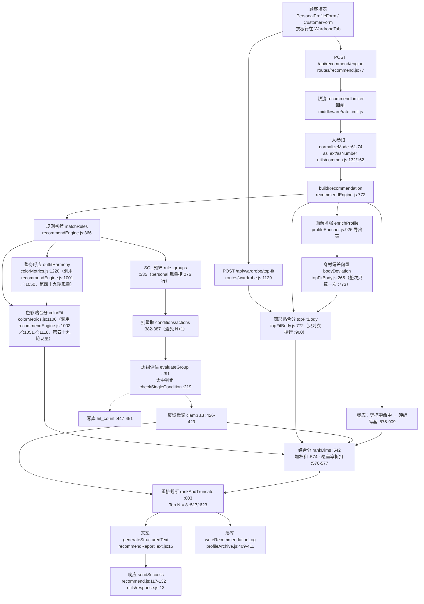
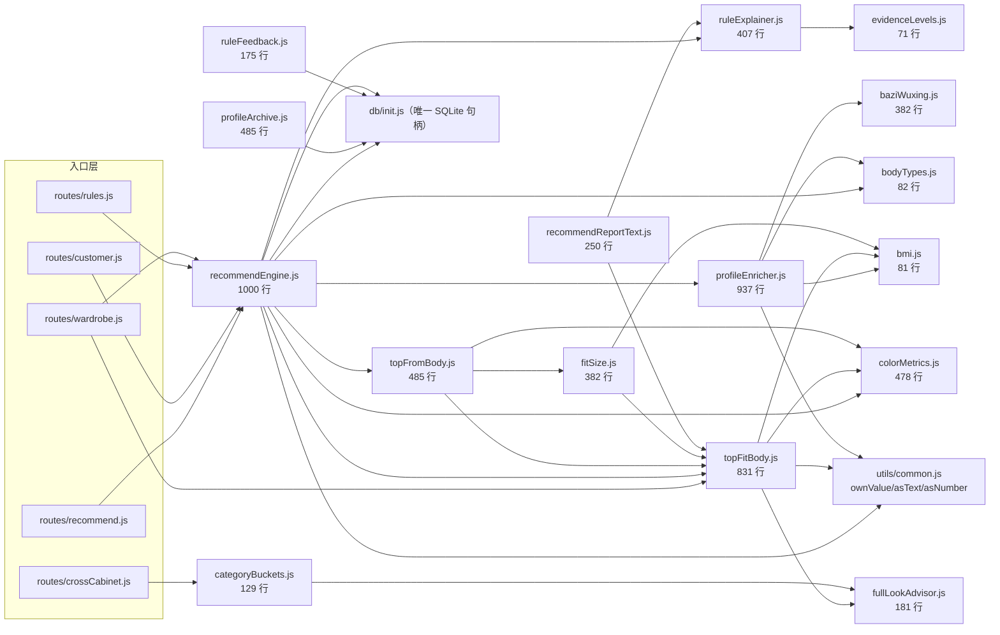
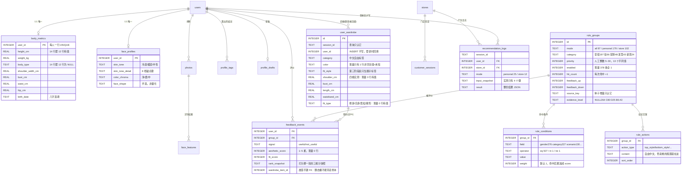

# 全项目架构审计与优化蓝图（2026-10-19）

> **一句话｜系统的骨架是干净的，数学也确实写进了代码，但三维打分在真实数据上目前只有一维在场——排序的决定权仍然在规则那一刀，"公式接管排序"现在是一台没有油的发动机。**

这份文档的读者是你（产品掌舵人），不是未来的我。所以每一条都写成"事实 + 它在哪一行 + 它意味着什么 + 动它要花多久"。

**取证口径（先读这段，否则下面的数字你没法信）**

- 所有行号按 `HEAD = abfdfe4`（第四十一轮·第三阶段）现量，判据＝`sed -n 'Np' 文件` 逐行回读真身，不是从旧文档抄的（⚠️ 10-20 第四阶段·第一步把 `recommendEngine.js` 从 1000 行加到 1115 行 ⇒ 本文指向它的那些号已随本轮重扫改口；改号账目与终态复核见 `docs/第四阶段进展报告-20261020.md` §十／路线 §四十二）。本文 110 个 `文件名:行号` 定位符已用工装逐条回读（`arch-20261019/loc-check.cjs`，超行/缺文件＝0）。
- 所有库内数字来自本机 dev 库 `backend/db/styleai.db`（1,118,208 B）的**仓外只读副本**，判据＝`SELECT COUNT(*)` 逐表数；服务器库我没有访问权限，本机数字**不代表线上**（这条差异见 §5.3-DR3）。
- 所有耗时来自同一份副本上跑 `buildRecommendation()` 各 20 次取分位，工装 `E:/website/站3产生临时文件/arch-20261019/arch-perf2.cjs`。
- 三张 Mermaid 图（数据流／模块依赖／ER）已在真浏览器里用本地 `mermaid@10.9.1` 逐块 `parse()` 与 `render()` 通过（3 块全 OK、出 3 个 SVG），工装 `arch-20261019/mermaid-check.html`。⚠️ 这验的是**语法能渲染**，不代表排版在你那边的美观度。
- 本文档自身的行数/字节是自指数，别抄；要复算：`wc -lc docs/架构审计与优化蓝图-20261019.md`。
- 诚实条款：文末 附录 B 列了我**没能验到**的东西（线上填写率、门店并发、`crossCabinet` 大库存曲线、服务器库现状）。凡是我推测的，句子里带"预估/推导"两个字。

> **⚠️ 10-20 第四阶段·第一步变更公告（本文是 10-19 那份体检的快照，以下三处已经不再是现状）**
> 排序层按你的指令改了三个参数：`RANK_WEIGHTS` 由 `{rule .2, color .4, body .4}` 改成
> **`{rule .1, color .45, body .45}`**（`recommendEngine.js:540`）；新增**算法缺席惩罚 0.8**
> （`:548`，只打规则来源的候选，衣橱行不吃）；新增 **Top 8 里算法在场下限 2 条**
> （`:563`，凑不出就不硬塞）。本文正文里所有 0.2/0.4/0.4 与"榜首 68 分纯规则条目"的读数
> 都是**改前**现状，逐条差分与新的实测名次见 `docs/第四阶段进展报告-20261020.md`。
> 本文不变的那条主结论没变，而且被这次改动更硬地证实了一次：**卡住系统的是数据，不是排序层。**

---

## 第 0 部分：先给结论（体检报告的总分）

这五条是这份文档的全部要点。后面四部分只是给它们配证据。

**结论 1｜"算法接管排序"目前没接管。** 实测：一个满档案（身高 165／体重 55／胸 88／腰 72／臀 96／肩 39／肤色冷皮·白皙／梨型／通勤）跑一次 personal 推荐，出来的 8 条穿搭候选里，**6 条规则命中条目的 coverage 全是 0.2、色彩与廓形两维双双缺席**，榜首 68 分完全由规则基础分决定；唯一量了四格实测的那件衣橱上衣拿 30.4 分。**分数最高的推荐，是那条一个字都没量过的规则文本。**（这条是 10-19 的读数。10-20 第四阶段·第一步把权重与惩罚改了之后同档案复跑：榜首换成带色彩分的那条 53.1，纯规则那条 68→51.2 退到第二——**换位真的发生了，但只在这一条档案上**；同一批档案里"只填身高体重"那种，池子里一条算法分都没有，榜首还是纯规则的 51.2，排序层无能为力。逐条差分见 `docs/第四阶段进展报告-20261020.md`。）

**结论 2｜色彩那一维（权重 0.4，三分之一的天下）在场率 15.1%。** 判据＝把库里 172 条穿搭规则的"上衣结论"逐条喂给 `colorFit()`，只有 26 条能翻出 Lab。换八档肤色锚点逐档重测，出分数**一模一样是 26** ⇒ 瓶颈不在肤色侧，在规则动作文案是"珊瑚粉、蜜桃色、鹅黄色针织衫或衬衫"这种自由中文，而色名词表只有 58 个键。整身呼应更差：上下装配对只有 **9/157（5.7%）** 凑得出两个可算色。

**结论 3｜廓形那一维（权重 0.4）在场率 0%——对规则条目永远是 0。** 这不是 bug，是第二阶段的**有意设计**（`recommendEngine.js:1015-1018` 明写"规则结论给的是自由文本，一格实测都取不到 ⇒ 这一维整块缺席"）。真正的问题是：能进这一维的只有用户自己衣柜里量过尺的那几行，而**本机库里 6 件衣橱行，四格实测 0 件、版型 0 件**（现量 `SELECT COUNT(*) ... WHERE shoulder_cm IS NOT NULL` 全 0）。第三阶段刚上线的"只选一档版型"兜底，数学上把覆盖率从 0 抬到 **0.08**，出分 14——**它进不了前 8，被 Top N 截掉了**。

**结论 4｜权重回归这台机器没有输入。** `feedback_events` 现量 **0 行**，两把星（`aesthetic_score`/`fit_score`）样本 0 条 ⇒ `backend/scripts/regress-rank-weights.js` 现在跑只会回"不可回归"。`RANK_WEIGHTS`／`FIT_TYPE_EASE`／`COVERAGE_PENALTY`／`AXIS_WEIGHTS` 这四组决定名次的东西，**全部还是手拍值**（代码注释自认"手拍"现量 **39 处**，10-20 复量、10-19 本条写的是 38；判据＝`grep -rn "手拍" backend/services/*.js | wc -l`；能改动名次的那一批列在 §2.6）。

**结论 5｜性能不是现在的瓶颈，写放大和数据不可复现才是。** 一次推荐 p50 3.7 ms、p95 5.1 ms（本机副本，`arch-perf2.cjs` 各跑 20 次取分位）——按人数外推：100 万用户每天各一场，也只是 100 万 × 4 ms ≈ **67 分钟 CPU 时间**，算力这一头现在不用担心。但：每次推荐对**每条命中规则**做一次 `UPDATE hit_count`（`recommendEngine.js:481-485`），现量每场 **11 次**（personal）／**14 次**（store），而 SQLite WAL 是**单写者**模型，写路径比读路径先痛；`recommendation_logs` 每行平均 **11.5 KB**（425,984 B / 37 行），而且里面存的 `input_snapshot` 实测只有 **4 个键**（gender/height/birthday/shichen）——**存了一大坨字节，却存不下能重算出这次结果的那份输入。**

一句话总结给决策用：**代码层的活基本干完了，卡住系统的是数据层没有数据。** 第四部分的短期项因此大半不是"改公式"，而是"把颜色词表、衣橱录入率、反馈入口这三根管子接上"。

---

## 第一部分：系统全景（The Big Picture）

### 1.1 核心数据流：从"填了身高体重肤色"到"屏幕上那条推荐"



**逐跳事实表**（每一跳都是实读行号；这张表是画图的底，也是以后改任何东西时的定位入口）

| # | 这一跳在干什么 | 位置 | 现量事实 |
|---|---|---|---|
| 1 | 顾客输入进后端 | `backend/routes/recommend.js:77`（POST `/engine`） | 另有 4 个入口：`routes/customer.js:297`（门店）、`routes/wardrobe.js:1026`（个人，写死 personal）、`:1129`（上衣按身材排）、`routes/rules.js:694`（后台试算） |
| 2 | mode 与 profile 归一 | `recommend.js:61-74`、`:83`、`:92` | mode 收敛到 store/personal 枚举，非对象直接 400 |
| 3 | 画像增强 | `recommendEngine.js:774` → `profileEnricher.js:926-952` 导出 | 算 BMI／体型／腰臀比／腿身比／肩宽比／四季·十二型／Kibbe／八字字段 |
| 4 | 身材偏差向量 | `recommendEngine.js:776` → `topFitBody.js:265` | 整次推荐只算一次；`want` 五轴 + `ease_window` |
| 5 | 规则初筛 | `recommendEngine.js:366` `matchRules` | 预筛 SQL `:369`；personal 口径**一次捞 276 行** rule_groups |
| 6 | 条件与动作装载 | `:382-387` | 批量 IN 查，避免 N+1；本机共 929 条件 / 1879 动作 |
| 7 | 命中判定 | `:291` `evaluateGroup` → `:219` `checkSingleCondition` | 操作符只有三种：`eq` 927 条、`in` 1 条、`ne` 1 条（现量） |
| 8 | 打分与反馈 | `:308-309` 权重累加、`:426-429` 反馈 clamp ±3 | 命中才入候选 `:414` |
| 9 | 色彩维 | `:856-860` 调 `outfitHarmony` + `colorFit` | **172 条上衣文案里只有 26 条出分**（15.1%） |
| 10 | 廓形维 | `:919-958` 只对 `profile.wardrobe_items` 里的上衣行 | 规则条目**永远不进这一维**（`:866-869` 有意为之） |
| 11 | 综合分 | `:542` `rankDims`，`:574` 加权和，`:576-577` 覆盖率折扣 | 一维都没有 ⇒ `null`，不进排序 |
| 12 | 重排截断 | `:603` `rankAndTruncate` → `:623` `slice(0, 8)` | N=8；被截掉的件数写进 `_ranked_out` |
| 13 | 兜底 | `:875` 穿搭零命中 → `getRecommendations`（`:31`） | 兜底条目 priority=0/score=0，同样只有色彩维可算 |
| 14 | 文案与落库 | `recommendReportText.js:15`；`profileArchive.js:409-411` | 日志只在登录态写（`recommend.js:108-114`） |
| 15 | 反馈写回 | `recommend.js:146` → `ruleFeedback.js:99`，`:125-126` UPSERT | `UNIQUE(user_id, group_id)` ⇒ 一人一规则只留最新一次 |

### 1.2 模块依赖关系（backend/services）



**这张图要说清的四件事**

1. **依赖是有向无环的**（判据＝上面这张图逐条 require 实读，`services/*.js` 内部 require 共 40 处）。唯一的"来回"是 `topFitBody ↔ colorMetrics`？不是：`topFitBody.js:88` 单向引 `colorMetrics`，`colorMetrics.js` 只引 `utils/common.js`。**没有循环依赖，没有 lazy require 补丁。**
2. **`recommendEngine.js` 是唯一的汇聚点**（引 7 个服务 + 直接摸 DB），它同时是"规则匹配""打分""排序""兜底""出账字段"五件事的现场——§5.1-D1 那条债务就是它。
3. **`fitSize.js` 与 `topFitBody.js` 互相引用**（`fitSize.js:39` 引 `topFitBody` 的 `meas/easeWindowFor/BODY_REF`，`fitSize.js:271` 又函数内 require 一次 `topFitBody.bodyDeviation`）——这是同一件事的第二处入口，改 `bodyDeviation` 时**必须同时看这两处**。
4. **只有 4 个服务直接摸 DB**：`recommendEngine`、`profileArchive`、`ruleFeedback`、`db/init` 自身。其余全是纯函数——这是这套代码最值钱的一条性质，也是"以后要上多实例/缓存"时最省事的性质（纯函数可以随便挪到 worker 里）。

### 1.3 数据库 ER 图（核心 12 张表）

全库 31 张表、32 条索引（现量 `grep -c "CREATE TABLE" db/schema.sql` = 31）。`PRAGMA foreign_keys = ON` 在 `db/init.js:39` 开着 ⇒ 下面这些 `REFERENCES` 是**真的在执法**，不是装饰。



**其余 19 张表一句话点名**（行数＝本机 dev 库现量）：`users` 48、`photos` 4、`face_features` **0**、`profile_tags` 42、`profile_drafts` 1、`recommendations` **0**、`tryon_results` 2、`clothing_items` 1、`inventory_categories` 6、`inventory_products` **0**、`stores` 2、`customer_sessions` **0**、`wardrobe_outfits` **0**、`shopping_wishlist` **0**、`admin_users` 1、`user_cosmetics` 4、`user_accessories` 3、`model_configs` 28、`deposits` 4、`payment_orders` 9、`creator_works` 1、`user_accounts` 6、`app_settings` 1。

**读法**：`face_features`、`recommendations`、`inventory_products`、`wardrobe_outfits`、`customer_sessions` 五张表**全空**——它们代表三条建了库但没接通业务的能力线（照片识别落库、旧推荐记录、库存商品、搭配组合、门店会话同步）。§4 的中期项里有三条就是冲着它们去的。

### 1.4 入口面与运行时（画进全景图的边界）

| 面 | 现量 | 位置 |
|---|---|---|
| HTTP 端点 | **137 个**（GET 62 / POST 52 / PUT 11 / DELETE 12），其中 `routes/admin.js` 8 个走 `/admin/api` | 判据＝`grep -rhoE "router\.(get\|post\|put\|patch\|delete)\(" routes/*.js` |
| 路由挂载 | 20 个 require、21 个 `/api/*` 前缀 + `/admin` | `server.js:322-342` |
| 总限流 | 100 次 / 15 分钟 / IP，豁免名单含 `/api/health` | `server.js:124-152`、豁免 `:142-147` |
| 后台闸 | `/admin/api` 不吃总闸，自带 600 次 / 60 秒 | `routes/admin.js:23-31` |
| 展厅 | `/gallery` 由后端直发 `app/public/model-gallery.html`（1575 行），与 `app/dist` 的 React 是**两套 HTML 并存** | `server.js:250-257`；React 侧 iframe 挂在 `ExhibitionHall.tsx:422` |
| 前端 | 单页状态机（standby/mode-select/form/report/rules），`app/src/api.ts` 42 个真打后端的函数 | `app/src/App.tsx:20`、`pages/ExhibitionHall.tsx:40` |
| 测试 | 38 份 `*.test.js`、533 个 `test(`，npm 报 560（差 27 个来自 describe 内参数化） | 判据＝`grep -hc "^\s*test(" test/*.test.js` 求和 |
| 外部服务 | 通义（试穿，无 Key 降级回原图）、Open-Meteo 天气、支付宝/微信（未配回落 503）；**`dashscopeService.analyzeFace` 全仓 0 调用方** | `routes/tryon.js:18/81-87`、`routes/weather.js:8`、`routes/payment.js:19-20` |

⚠️ 最后一行那条是全景里最容易被忽略的一块：**系统里已经接进来一个能看脸的大模型，但没有任何一行代码调用它的人脸分析函数**（`services/dashscopeService.js:84` 定义、`:326` 导出，调用方 0）。`POST /api/analysis/face` 直接回 501（`routes/analysis.js:31-33`）。也就是说"脸型量化"这件事**不是从零开始**，是从"能力已在、管道未接"开始——这决定了 §4 中期项 M3 的工作量估算。

---

## 第二部分 核心算法与数学模型审计（The Math）

### 2.0 这一部分的一句话结论

**公式是真的，参数是拍的，数据是没进来的。** 三层评分（色彩 / 身体 / 排序）在代码里都是可复算的确定性函数，我把它们逐条拆在下面并各配了一组现量数值；但每一层里"决定名次的那个数字"——权重、阈值、参考带——全部是本项目自己拍的（代码注释里有 **38 处**自认"手拍"，判据＝`grep -rn "手拍" backend/services/*.js | wc -l`，22:5x 现量）。更关键的是：**在真数据上，综合分现在只有一维在场**（§2.4 实测），所以"数学接管排序"这件事目前是架构成立、供给为零。

数值例全部出自 `E:/website/站3产生临时文件/arch-20261019/math-examples.cjs`（只读模块，输入是我手造的档案与衣橱行，不落库）与 `color-dist.cjs`（58 色名 × 8 肤色档 = 464 对全枚举）。

### 2.1 算法清单

| # | 算法 | 位置 | 干什么 | 依据档位 | 在真数据上跑了吗 |
|---|---|---|---|---|---|
| 1 | CIEDE2000 色差 | `colorMetrics.js:75-121` | 肤色 Lab × 衣色 Lab → ΔE00 | **A**（GB/T 7921-2008 / ISO-CIE 11664 侧；实现按 Sharma 2004 系数） | 是 |
| 2 | 色相对比角 Δh | `colorMetrics.js:60-65` | 两色 hue 角差（0~180） | 计算本身中性，用途是 B（Schloss & Palmer 2011） | 是 |
| 3 | 色彩贴合分 `colorFit` | `colorMetrics.js:1106-1200` | 三轴加权和 × ΔE 闸门，再与呼应分混合 | A 公式 + B 方向 + **C 权重** | 是，但只在 15.1% 的规则条目上出分（§3.1） |
| 4 | 整身呼应 `outfitHarmony` | `colorMetrics.js:1452-1486` | 单品两两 ΔE00 按面积乘积加权 | A 公式 + **C 面积权重** | 衣橱侧 9/157 配对（§3.1） |
| 5 | 体型偏差向量 `bodyDeviation` | `topFitBody.js:265-417` | 人身净尺寸 → 六轴"往哪修"want ∈ [−1,1] | B 方向 + **C 参考带与跨度** | 是（六轴里 length 常在带内 ⇒ 不出分） |
| 6 | 成衣修形向量 `describeTop` | `topFitBody.js:494-742` | 衣柜一行的实测 cm → 六轴 given | **C 刻度**（四条比例无国标原文） | 现量：衣柜 6 行实测全空 ⇒ 只走版型估算那条 |
| 7 | 对齐函数 `align` | `topFitBody.js:751` | want 与 given 同向程度 0~1 | 本项目自建刻度 | 是 |
| 8 | 松量窗评分 `easeScore` | `topFitBody.js:754-759` | 落窗不扣分，越窗每 6cm 归零 | B 方向（Liu 2006）+ **C 窗口与 6cm** | 是 |
| 9 | 覆盖率惩罚 | `topFitBody.js:173`、`:869-876` | `Final = Raw × (0.5 + 0.5·Coverage)` | **C 手拍锚点**（有推导判据） | 是，实测因子 0.54~1.0 |
| 10 | 综合分 `rankDims` | `recommendEngine.js:622-677` | 三维加权 + 覆盖率折扣 | **C 权重** | 是，但只有 1~2 维在场 |
| 11 | 固定区间归一 `normTo` | `recommendEngine.js:606-613` | priority/score → 0~1，出界钉端点 | 参照区间＝现量分布（非文献） | 是 |
| 12 | GB/T 1335 号型推算 `fitLayer` | `fitSize.js:269-382` | 身高/胸围/胸腰差 → 号、型、Y/A/B/C | **A/B 国标**（本机 PDF 逐字核对） | 是，但**不进排序**（§2.5） |
| 13 | 上衣处方 `topSpec` | `topFromBody.js`（引擎调用点 `recommendEngine.js:834`） | 无衣服时按身体+肤色出规格表 | B 方向 + C 词表 | 是，走文案不进名次 |
| 14 | 反馈修正（±3 分） | `recommendEngine.js:460-463` | 净好评 clamp 后进规则分 | **无依据**（工程口径） | 现量 0 样本 ⇒ 从未触发 |
| 15 | 权重回归 `regress-rank-weights.js` | `backend/scripts/regress-rank-weights.js` | 从反馈反推 w1/w2/w3 | 形状与线上公式一致（凸组合、无截距） | 设计如此，现常态输出"样本不够，不可回归" |

⛔ 第 14、15 条要说清楚：它们**已经写完并有测试**，但被 `feedback_events` 现量 **0 行**这件事整块饿住。这两条不是我承诺的未来功能，是"管道已建、水没来"的现存事实（§3.1 第 4 行）。

### 2.2 色彩层：`colorFit`

**第 ① 步 CIEDE2000**（`colorMetrics.js:75-121`，逐字对照 Sharma 2004 标准系数，`kL=kC=kH=1`）：

```
G   = 0.5·(1 − √(C̄⁷ / (C̄⁷ + 25⁷)))           :80   C̄ = (C1+C2)/2
aᵢ' = aᵢ·(1+G)                                 :81-82
Cᵢ' = √(aᵢ'² + bᵢ²),  hᵢ' = atan2(bᵢ, aᵢ')     :83-86
ΔC' = C2'−C1',  Δh' = 色相角差(±360 归一),      :87-97
ΔH' = 2·√(C1'·C2')·sin(Δh'/2)                  :97
L̄' C̄' h̄' = 两侧均值（h̄' 走 360 分支）          :98-104
T   = 1 − 0.17cos(h̄'−30) + 0.24cos(2h̄')        :105-110
        + 0.32cos(3h̄'+6) − 0.20cos(4h̄'−63)
SL  = 1 + 0.015(L̄'−50)² / √(20+(L̄'−50)²)      :110
SC  = 1 + 0.045·C̄'                             :111
SH  = 1 + 0.015·C̄'·T                           :112
Δθ = 30·exp(−((h̄'−275)/25)²)                   :113
RC  = 2·√(C̄'⁷/(C̄'⁷+25⁷)),  RT = −RC·sin(2Δθ)  :114-115
ΔE00 = √[(ΔL'/SL)² + (ΔC'/SC)² + (ΔH'/SH)² + RT·(ΔC'/SC)(ΔH'/SH)]   :116-121
```

参数含义：`SL/SC/SH` 是明度/彩度/色相三个方向的感觉权重（中性色附近明度最敏感）；`RC/RT` 是蓝紫色区（h̄′≈275°）的旋转修正，那段里同样的 ΔC′ΔH′ 该被评成更大差异。`T` 是四个余弦项拼出来的色相位置调节量。**这一层没有拍的数**——0.5、25⁷、0.015、0.045、0.17/0.24/0.32/0.20、30、25 全是 CIE/Sharma 定死的常数，代码逐字对应。这是全项目唯一一处可以对外说"国标公式"的地方。

**第 ② 步 三轴对比分**（`colorMetrics.js:1143-1161`，10-20 第四十九轮现号）：

```
hueContrast = 0.5 + clamp01(Δh / 360)          :363   ← 色相差越大越被偏好（Schloss & Palmer 2011）
brighten    = clamp01((L_肤 − L_衣) / 40)       :365   ← 衣装越暗脸越显白（Zhang 2025）
chromaMatch = 1 − clamp01(|ΔC| / 60)           :366   ← 彩度差越大越不搭
contrastScore = 100·(0.45·hueContrast + 0.35·brighten + 0.20·chromaMatch) × gate   :368-376
```

三个分母 **360 / 40 / 60** 和三个权重 **0.45 / 0.35 / 0.20** 全是 C 档（`WEIGHTS` 定义在 `:283`，注释原话"手拍，未回归（C 档）"）。

**第 ③ 步 ΔE 闸门**（`:312-328`）：

```
gate(ΔE) = 0.85                     ΔE ≤ 15
         = 0.85 + (ΔE−15)/15·0.15   15 < ΔE < 30
         = 1                        ΔE ≥ 30
```

语义：衣服跟脸太像（ΔE<15）＝"糊成一团"，扣 15%；ΔE>30 完全分开，不扣。**15/30 这两个切点取的是本库 464 对色名×肤色档分布，不是文献 JND**（现量：`gate < 1` 的配对 **308/464 = 66.4%**，即三分之二的组合会吃到这道折扣）。这个口径我在 `11-后台算法与量化模型披露` 里读到的是 66.6%，与本次 66.4% 差 1 对（应是 464 对里某对 ΔE 落在切点边上随取整漂移）——**两个数都按各自命令可复算，不冲突，但别混着引**。

**第 ④ 步 呼应混合**（`:378-383`、`:319`）：

```
score = contrastScore                                   （没有第二件时）
      = 0.7·contrastScore + 0.3·harmony                 （整身有搭配时）   HARMONY_SHARE = 0.3
```

`outfitHarmony`（`:425-459`）＝ 单品两两 `100 − min(ΔE00, 100)`，按**面积权重乘积**归一加权；面积权重口径在 `:407-420`（写 0 照用，只有 NaN/负数/没填才退成 1）。

**无彩色那一条**（`:295`、`:362`）：`C < 5` 时色相角是 `atan2(0,0)` 造出来的假数 ⇒ `hue_applies=false`，该轴**记 0.5（它自己的最小值）而不是把 45% 权重摊给另外两轴**。摊过去等于黑上衣凭空涨分——这条写法是对的，值得留在文档里当正面样本。词表 58 个色名里 C<5 的正好 9 个（白/黑/墨黑/浅灰/中灰/冷灰/枪灰/银灰/银色）；464 对里有无彩色参与的 **72 对（15.5%）**。

**现量数值例**（肤色档「自然」= `L57 a10 b19`）：

| 衣色 | ΔE00 | gate | hue | brighten | chromaMatch | 总分 |
|---|---|---|---|---|---|---|
| `#1F3A5F` 深藏青 | 41.5 | 1 | 0.904（Δh 145.5°） | 0.822 | 0.937 | **88** |
| `#000000` 黑 | 46.0 | 1 | 0.5（无彩色） | 1.00 | — | **70** |
| `#C0392B` 砖红 | 22.7 | 0.927 | 0.571 | 0.31 | — | **39** |
| `#FFFFFF` 白 | 34.0 | 1 | 0.5（无彩色） | 0.00 | — | **35** |
| `#FFCC00` 亮黄 | 30.9 | 1 | 0.570 | 0.00 | — | **26** |

手工复核第 1 行：`100·(0.45·0.904 + 0.35·0.822 + 0.20·0.937)·1 = 88.2` → 取整 88，与函数返回一致。

**这一层的四个真实问题（不掩饰）**

1. **`brighten` 在 61% 的配对里饱和为 0**（464 对中 283 对为 0、20 对拉满、161 对中段 ⇒ **65.3% 卡在两端**）。一件比脸亮的衣服在这条轴上一律 0 分，白、亮黄、浅粉三者在这一维完全无法区分。分母 40 定得太窄。
2. **色彩分整体偏低且窄**：464 对全枚举 score 分布 `min 23 / p25 35 / 中位 41 / p75 56 / max 93`。而规则分被 `normTo` 归到 0~100 全域。名义上 color 与 rule 权重 0.4 vs 0.2，**有效影响力远没有 2 倍那么温和**——中位色彩分 41 折算进综合分只有 `0.4×41=16.4`，一条 priority 30/score 9 的规则贡献 `0.2×100×0.68=13.6`（§2.4），两者几乎同级，色彩并不占优。（⚠️ 这一折算用的是改前 0.2/0.4/0.4；10-20 改后同一档案的实测是色彩在场那条 53.1 压过纯规则那条 51.2 ⇒ 影响力排序确实翻过来了，但翻的幅度只有 1.9 分，靠的是惩罚而不是权重——见进展报告 §二。）
3. **色名覆盖率决定这一维存不存在**：规则结论那句 `top_style` 自由文本里能认出词表色名的只有 26/172（15.1%），详见 §3.1。
4. **词表只有 58 个色名**（`:149-`），且按 `db/seed/rules-aesthetic*.json` 真出现过的词收口（注释原话）。任何规则文案写了词表外的颜色 ⇒ 静默不给分（返回 null，不是给 0），前端不会报错——这是"看起来在打分、其实那一维根本没进"的典型形态。

### 2.3 身体层：`want × given` 六轴

**这一层的设计前提**（`topFitBody.js:761-771` 的函数注释、`:866-867` 的在场过滤）：每一维都要**两侧齐**才出分——人那一侧 `want` 不为 null，且衣那一侧 `given` 不为 null。任一缺失 ⇒ 该轴不进分母（不补 0，见 `08 §8 硬规矩`）。

**人的偏差向量 `want`（`bodyDeviation`，六轴各一条公式）**：

```
肩线   want.shoulder = mean( 三个信号 )                        :275-301
        ① 肩宽比 = 肩宽/身高×100，离 [21,24] 带每 1 个百分点 ±1/3（span 3，:101-102）
        ② SHR = 肩宽/净腰围，离 [0.44,0.57] 每 0.1 拉满（span 0.1，:107-108）
        ③ 臀−胸差 >0 ⇒ +clamp01(差/8)；<0 ⇒ 只 clamp(差/12,−1,0)   :295-297
腰线   want.waist = clamp((min(胸−腰, 臀−腰) − 9) / 6, −1, 1)  :304-318
        （9 = (waist_strong 12 + waist_flat 6)/2，:113-115）
腰位   want.length = ±clamp01(离 [0.52,0.56] 腿身比 / 0.04)     :321-326
体量   want.volume = −1                     BMI ≥ 28           :331
                 = −clamp01(0.3+(BMI−24)/4)  24 ≤ BMI < 28      :332-333
                 = +clamp01((18.5−BMI)/4)    BMI < 18.5         :334
                 = 0                          18.5 ≤ BMI < 24    :335
条纹   want.pattern = want.volume，BMI ≥ 25 时整条置 null        :338-350
松量   ease_window = BMI 分档取 [1,4]/[2,7]/[3,10]/[4,8] cm      :121-126、:384-389
```

**衣的修形向量 `given`（`describeTop`，只吃实测 cm）**：

```
肩线   shoulder = clamp( ((shoulder_cm − 净肩宽)/身高×100) / 3, −1, 1 )   :513-517
腰头   waist    = clamp( 2·waistband_cm / 5 − 1, −1, 1 )   ← 5cm 拉满，0 合法  :526-529
腰位   length   = clamp( (身高×0.40 − length_cm) / 12, −1, 1 )            :538-543
体量   volume   = 0.65·lightnessDir + 0.35·bulk                           :569
        lightnessDir = clamp((L* − 50)/40, −1, 1)（深→负=收缩）            :557
        bulk = FABRIC_BULK[薄/中/厚] = −0.4 / 0 / +0.6                    :396
条纹   pattern  = {竖条/竖条纹: +1, 横条/横条纹: −1}，别值一律不算          :376、:578-587
松量   ease     = bust_cm − 净胸围（实测）
               或 FIT_TYPE_EASE[版型档].range 的中值（估，按半格计）        :489-508
```

**版型映射（第三阶段·模块一，`FIT_TYPE_EASE` `:185-193`）**：修身 `[0,2]`→1.0、合身 `[2,7]`→4.5、宽松 `[8,15]`→11.5、廓形 `[15,26]`→20.5。`easeFromFitType`（`:196-202`）**认不到就回 null，不做"就近归档"**——把"紧身/oversize"这类自由词猜成某一档，等于回到认字打分。

**打分（`:638-754`）**：

```
align(w,g) = 1 − |w − g| / 2          同向=1，反向=0；取均值不取乘积，防止一维打死总分
easeScore(win,e) = 1 − clamp01(越窗距离 / 6)
raw    = Σ(wᵢ·sᵢ) / Σwᵢ              只在在场轴之间归一      :747-748
penalty = 0.5 + 0.5·coverage          COVERAGE_PENALTY        :160、:753
coverage = Σ(在场轴计权) / 6           实测轴计 1、版型估的轴计 0.5  :616-628
score  = round(rawScore × penalty)                                :754
```

**现量数值例**（女，163/55，肩 38 胸 86 腰 72 臀 92 腿长 88，肤色「自然」；`want = {shoulder 0.75, waist 0.83, length null, volume 0, pattern 0}`，`ease_window [2,7]`）：

| 这件上衣填了什么 | 在场轴 | raw | coverage | penalty | score |
|---|---|---|---|---|---|
| 肩 40 / 胸 94 / 长 62 / 腰头 4 / 版型「合身」/ 白色 / 面料中 / 竖条 | shoulder, waist, volume, ease, pattern（length 缺席：`want.length` 为 null） | **86** | 1.00 | 1.00 | **86** |
| 只选了一个版型「宽松」，四格全空 | ease（估，半格） | 25 | **0.08** | 0.54 | **14** |
| 只量了衣长 70cm | 无（人那一侧 `want.length` 在参考带内＝null ⇒ 这一维两侧不齐） | — | — | — | **null（不打分）** |

第 2 行是**版型兜底那条路的真实天花板**：即便估出来的松量恰好满分，`coverage 0.08` 只能买到 `penalty 0.54`，出 14 分——它进不了排序前列（§2.4 会看到这条在综合分里被截掉）。第 3 行暴露一条设计后果：**量了但人不推拉 ⇒ 白量**。腿身比在带内的人，衣服长度这一维永远不会产生分。

`COVERAGE_PENALTY` 的 0.5 不是随手拍的（`:150-158` 有推导）：它要保证「只量出一格且恰好满分」≤ 满分一半，越不过「量到两格、两格都一般」那一档。`span 0.5` 保证覆盖率 1 ⇒ 因子恰好 1（量齐的不打折）。**这条推导是自洽的，但它惩罚的是"依据薄"，不解决"依据根本没来"**——那要 §4 的短期项 S3。

### 2.4 排序层：`rankDims`

```
综合分 = [Σ wᵢ·sᵢ / Σ wᵢ] × f × 算法缺席惩罚          recommendEngine.js:622-677
w = {rule 0.1, color 0.45, body 0.45}                                     :506（⚠️ 10-20 改前是 0.2/0.4/0.4；这一行按产品指令改的，仍 C 档手拍）
rule 分 = 100·(0.5·normTo(priority,[15,30]) + 0.5·normTo(score,[1,9]))    :591-597
f = 0.6 + 0.4·coverage,  coverage = Σw_present / Σw_应有                  :622-623
惩罚 = 规则来源且色彩/廓形任缺一维 ⇒ ×0.8（缺几维都只乘一次；衣橱行不吃）  :624-630、常量 :548
应有权重和：规则条目 = rule+color+body；衣橱条目 = color+body（规则分对它是天然缺席）
名次并列 → priority 降 → 命中权重降 → group_id 升 → 名称字典序              :646-650
截前 RANK_TOP_N = 8；再保证 Top 8 里算法在场 ≥2 条（凑不出不硬塞）          :551、:563、:681-735
```

三处写法值得单独点名（它们是这个模块的正面资产）：① `normTo` 用**固定分母**而不是"这批里的最大最小"，所以同一条规则换个场合不会变分（`:508-515`）；② 空值挡在 `Number()` 之前，`Number(null)=0` 不会把"没填"读成"填了 0"（`:569-575`）；③ `FLOOR=0.6` 带一条反推判据（`:517-531`）：一整维缺席的候选不得越过"其余各维相同、那一维恰好等于其余维平均分"的候选 ⇒ 必须 `FLOOR < 0.76`，取 0.6 留余量。（⚠️ 10-20 加了 0.8 惩罚后这条判据重推过：补"等于其余维均值"的分本来就不改 raw，惩罚 <1 就让判据自动成立 ⇒ `FLOOR<0.76` 不再是那道最紧的约束，`:525-528` 注释里写明了。）

**现量数值例（同一份代码、三种在场情况）**：

| 候选 | 在场维 | raw | coverage | f | 综合分 |
|---|---|---|---|---|---|
| 规则命中 priority 30 / score 9 | rule(100) | 100 | 0.20 | 0.68 | **68** |
| 规则命中 priority 15 / score 1 | rule(0) | 0 | 0.20 | 0.68 | **0** |
| 衣橱一行，色彩 60 + 身体 86（覆盖率 1） | color, body | 73 | 1.00 | 1.00 | **73** |

再叠上活库真实跑出来的两组（`arch-perf2.cjs`，112 场 personal 推荐）：**规则侧候选 8 条，分数 68 / 45.6 / 21.1 / 19.7 / 15.6 / 15.6 / 15.6 / 4.1，全部 coverage 0.2（只有 rule 一维在场）**；衣橱侧只进了 2 条，综合分 **30.4**（body_fit 38、raw 45、penalty 0.84、coverage 0.67）。

这张表就是本报告最重要的一句实话：**"三维加权"的架构已经跑起来了，但真数据上它退化成"一维加权 × 0.68"**。一条 priority 30 的规则（68 分）稳压一件量了四格尺寸的上衣（30.4 分）——不是算法错，是**上衣那一侧根本没尺寸可量**（`user_wardrobe` 现量 6 行，四格实测与 `fit_type` **全空**）。同时第 2 行说明另一半风险：低优先级规则被归一成 0 分后 `×f` 还是 0，直接沉底，**规则库的 378 条里有相当一部分永远排不进前 8**（§3.3）。

### 2.5 号型层：`fitSize`（GB/T 1335，A 档，但它不参与排序）

```
号 = 就近 5cm 档（身高）      型 = 就近 4cm 档（净胸围）        SIZE_STEPS :49-72
体型 = 胸腰差 drop = 净胸围 − 净腰围 → Y/A/B/C                  DROP_BANDS :86-99
       男 Y[17,22] A[12,16] B[7,11] C[2,6]／女 Y[19,24] A[14,18] B[9,13] C[4,8]（边界含内）
常用档系按性别分表（女 145~180 / 男 155~190，胸围四体型各自收窄） :57-68
成衣胸围目标 = 净胸围 + 松量窗口                               checkBustEase :147-175
肩缝落点容差 = 正肩 ±1.5cm／落肩 ≥ +3cm    ⚠️ C 档手拍         SHOULDER_TOLERANCE :103
```

这一层的数值是**从本机国标 PDF 逐字核对过的**（`docs/依据/10 §2/§2b`），是全项目依据最硬的一层。但它是**另一套结论**：`topFromBody.js:468-476` 明文规定"第 0 层（买哪一档）与第 1 层（往哪修）允许互相反对，不许平均成一个分数"。⇒ 现状是**号型层算出来了，但排序层看不见它**。这是 §4 短期项里最便宜的一个可做点（把 `fitLayer` 的成衣胸围区间当作 body 层的一条硬校验，而不是新造一维）。

### 2.6 「拍脑袋」参数清单

代码里自认"手拍"的注释 **39 处**（10-20 复量；10-19 写这份蓝图时是 38 处，多的一处是第四阶段第一步给新惩罚写的自认。分模块：`topFitBody` 12、`topFromBody` 9、`fitSize` 8、`recommendEngine` 6、`colorMetrics` 4）。下面只列**能改动名次**的那一批，按影响半径排序：

| 参数 | 现值 | 位置 | 动了会怎样 | 标定路径 |
|---|---|---|---|---|
| `RANK_WEIGHTS` | rule **.1** / color **.45** / body **.45**（⚠️ 10-20 第四阶段·第一步改前是 .2/.4/.4，按产品指令改的，仍是 C 档手拍） | `recommendEngine.js:540` | 决定三维谁说话。当前 body 常年缺席 ⇒ 实际只有 rule 说话；⚠️ 单改这一行**不会**让算法接管（在场维归一化会把权重约掉，实测 0.68→0.64），要配下面那条惩罚 | `scripts/regress-rank-weights.js`（已就绪，等样本） |
| `RANK_ALGO_ABSENCE_PENALTY` | 0.8（**10-20 新增**） | `recommendEngine.js:582` | 只打规则来源的候选：缺色彩或缺廓形 ⇒ 总分 ×0.8，缺几维都只乘一次；衣橱行不吃 | 同上（惩罚系数本身就是那条"算法缺席"的证据） |
| `RANK_MIN_ALGO_IN_TOP` | 2（**10-20 新增**） | `recommendEngine.js:597` | Top 8 里至少 2 条算法在场，不够就从算法分高的补位；池子凑不出就不硬塞（`_algo.forced_in` 现量本机 0 ⇒ 这条目前只被单元测试触发过） | 看 `_algo.in_pool` 涨没涨，没涨是数据问题不是参数问题 |
| `WEIGHTS`（色彩三轴） | .45 / .35 / .20 | `colorMetrics.js:981` | brighten 占比高但它 61% 饱和 ⇒ 现在是在给一个常数配重 | 同上（快照里有 color 分量） |
| `FUSION_GATE` | lo 15 / hi 30 / min 0.85 | `:312` | 66.4% 配对吃折扣；改成 10~25 会多扣一批 | 现成 464 对分布可重算切点 |
| `brighten` 分母 | 40 | `:365` | **调大能直接解掉 61% 饱和**（40→80 时中段比例显著上升） | 无文献值，只能站内标 |
| `chromaMatch` 分母 | 60 | `:366` | 影响最小（权重只有 0.20 且分布偏松） | 同上 |
| `HARMONY_SHARE` | 0.3 | `:319` | 衣橱配对现 9/157 ⇒ 绝大多数单品拿不到这一项 | 需搭配数据攒够 |
| `ACHROMATIC_C` | 5 | `:295` | 决定灰阶衣服走"无信息 0.5"还是走假色相 | 词表内 9 个色名，可逐条看 |
| `AXIS_WEIGHTS` | sh .2 / waist .18 / ease .22 / length .16 / volume .18 / pattern .06 | `topFitBody.js:145` | 六轴谁重要。**pattern 只 .06 且带 BMI 闸门＝设计意图是让它几乎不影响** | 手拍，标定中（注释原话） |
| `COVERAGE_PENALTY` | floor .5 / span .5 | `:160` | floor 抬到 .7 ⇒ "只量一格"从 14 分变 19.6 分，惩罚失去意义 | 有推导判据，动它要重证 |
| `FIT_TYPE_EASE` | 4 档区间（中值 1/4.5/11.5/20.5） | `:185-193` | 版型兜底那条路的唯一供给；宽松档上端 15 是他给的例子 | Sakata 2020 只有 fit 款 1~7 |
| `ESTIMATED_AXIS_WEIGHT` | 0.5 | `:205` | 估的那格算半格；改成 1 就等于承认估的和量的一样可信 | 口径问题，不是数值问题 |
| `BODY_REF` 三条带 | 肩宽比 [21,24]、SHR [0.44,0.57]、腿身比 [0.52,0.56] | `:101/107/110` | 带内 ⇒ `want` 为 null ⇒ **整维消失**（§2.3 第 3 行） | GB/T 10000-2023 百分位读不到原值【无法证真】 |
| 三条 span | 3 / 0.1 / 0.04 | `:102/108/111` | 决定"离带多远算拉满"＝want 的斜率 | 手拍 |
| 腰线刻度 | strong 12 / flat 6 / span 6 | `:113-115` | 腰沟 <6cm 的人几乎永远 want≈负 ⇒ 收腰款一律扣分 | 产品刻度 |
| BMI 切点 | 18.5 / 24 / 28 | `:117-119` | 有国标（GB/T 31901-2024 表 A.2），但**该版 2026-12-01 才实施** ⇒ 现为内部口径 | 日期到了自己升档 |
| `ease_windows` | 4 档 [1,4]/[2,7]/[3,10]/[4,8] | `:121-126` | 松量轴的唯一标尺；Liu 2006 是 n=9 中国男性 | 小样本，方向可用 |
| `stripe_bmi_max` | 25 | `:128` | 关掉条纹轴；影响面小（权重 .06） | Ashida 2013 方向 |
| `GARMENT_REF` | 0.40 / 0.24 / 12cm / 5cm | `:366-374` | 0.24 目前**没有任何算法在读**（只用 0.40 与 12、5）；12/5 决定 length、waist 两轴的满量程 | 站内自建，⚠️ 无国标原文 |
| `FABRIC_BULK` | 薄 −0.4 / 中 0 / 厚 +0.6 | `:396` | 只影响 volume 轴的 35% | 经验值 |
| volume 混合比 | 0.65 / 0.35 | `:569` | 明度 vs 面料厚薄谁说话 | 手拍 |
| `align` 分母 | 2 | `:638` | 定死"反向=0、同向=1"，形状不可调（调它＝换模型） | 结构常数 |
| `easeScore` 归零距离 | 6cm | `:645` | 越小越苛刻；宽松档估的 11.5cm 对上 [2,7] ⇒ 越窗 4.5cm ⇒ 0.25 分 | 手拍 |
| `RANK_RULE_REF` | priority [15,30] / score [1,9] | `recommendEngine.js:828` | 参照区间＝现量分布，但**现量 enabled 378 条里有 94 条（24.9%）priority < 15**（priority 5 一档就占 76 条）⇒ 它们那一半被 `clamp01` 钉成 0，规则分封顶只有 50 | 分布变了要重标 |
| `RANK_COVERAGE_FLOOR` | 0.6 | `:514` | 单靠这一维的候选最高只能拿 68 分 | 有推导判据 |
| `RANK_TOP_N` | 8 | `:517` | 展示条数；现量每场候选 6~9 条 ⇒ 现在几乎不截，人一多就截 | 产品口径 |
| `NEUTRAL_BAND` | 0.15 | `topFromBody.js:40` | |want|<0.15 不给方向建议 | 手拍阈值 |
| `SHOULDER_TOLERANCE` | ±1.5 / +3 | `fitSize.js:103` | 肩缝判据；注释自认"版型行业经验，无标准无论文" | 需真人试穿数据 |
| 反馈修正 | ±3 分 | `recommendEngine.js:460-463` | 现量 0 样本 ⇒ 从未生效 | 需 ≥100 样本 |

### 2.7 敏感度：动哪个数最狠

按"改一个数能改变多少条候选的名次"排（这条排序基于 §2.4 的真实分布，不是猜）：

1. **不是任何权重，而是 `user_wardrobe` 四格实测的填写率**。当前 body 维在场率 0%，任何权重调整都是在给一维说话的场景调音。这是本报告把 §3 排在 §4 前面的原因。
2. `RANK_COVERAGE_FLOOR`（0.6）与 `RANK_WEIGHTS`：只要 floor > 0.66 左右，规则单维候选就会压过所有量了尺寸的衣橱候选 ⇒ body 层永远进不了前 8。floor 的安全区间已经被 `:507-513` 那条判据钉死在 0.76 以下。
3. `brighten` 分母 40 → 80：色彩分中段分布变宽，26/172 出分的那批条目内部名次会重排。
4. `FIT_TYPE_EASE` 与 `ESTIMATED_AXIS_WEIGHT`：把半格改成整格，14 分那条能到 ~21 分，仍然打不过规则候选 ⇒ 说明"只选版型"这条路的天花板不在惩罚系数，而在**只有 1 根轴在场**。
5. `AXIS_WEIGHTS` 六轴之间互相调：影响最小（同一件衣服在场轴少时，权重比只是重新分蛋糕）。

---

## 第三部分 数据流与瓶颈分析

### 3.0 一句话

**这套系统不缺算法，缺的是能进算法的数。** 下面每一格都是本机 dev 库现量（`E:/website/3.personal-image-ai/backend/db/styleai.db` 只读副本，31 表）。写这一节的目的是给出一个可核对的判断：**三维评分里现在只有一维有数据源**。

### 3.1 数据缺口（供给侧）

**A 人体侧——`body_metrics` 现量 14 行，非空计数：**

| 字段 | 有值行数 | 哪条公式因此跑不起来 |
|---|---|---|
| `height_cm` | 12 / 14 | "号"（5cm 档）与 `want.length` 的分母；缺 ⇒ `fitLayer` 直接 blocking |
| `weight_kg` | **6 / 14** | BMI ⇒ `want.volume`、`want.pattern`、`ease_window` 三样全丢 |
| `shoulder_width_cm` | **1 / 14** | 肩宽比与 SHR 两条信号 ⇒ `want.shoulder`；成衣肩宽也白量（减法要两侧） |
| `bust_cm` | 3 / 14 | 净胸围 ⇒ 松量实测（只能退到版型估）、号型的"型"、胸腰差 |
| `waist_cm` | 3 / 14 | 腰线 `want.waist`、胸腰差 → Y/A/B/C 体型 |
| `hip_cm` | 3 / 14 | 肩线第三信号（臀−胸）与腰沟取 min |
| `leg_length_cm` | 2 / 14 | 腿身比 ⇒ `want.length` |
| `body_type` | 2 / 14（NULL 12） | 规则条件字段，非量化层 |
| `leg_length_ratio` | **0 / 14** | 列存在但从未写过 ⇒ 死列（新代码用 `leg_length_cm`） |

⚠️ 这张表解释了一件关键事：**`want` 向量在真实用户身上通常只剩 0~2 根轴**。`want` 缺 ⇒ 衣橱那件衣服量得再全也不出分（§2.3 第 3 行实测的正是这一格）。

**B 衣橱侧——`user_wardrobe` 现量 6 行，逐列非空计数：**

| 字段 | 有值行数 | 后果 |
|---|---|---|
| `shoulder_cm` / `bust_cm` / `length_cm` / `waistband_cm` | **全 0 / 6** | 四格实测一条都没有 ⇒ body 层只能走版型估 |
| `fit_type` | **0 / 6** | 第三阶段刚加的必填字段，**历史 6 行没回填** ⇒ 连"估"这条路也拿不到输入 |
| `color` | 1 / 6（值是"未知"） | `resolveColor('未知')` 认不到 ⇒ `volume` 轴的明度侧缺席 |
| `pattern` / `fabric_weight` / `fit_style` | 0 / 6 | 条纹轴、体量轴没有输入 |

现量整表内容（`SELECT ... FROM user_wardrobe`）：`衬衫/真丝衬衫`、`裤子/阔腿裤`、`开衫/羊绒开衫`、`连衣裙/焦糖色连衣裙`、`外套/测试-外套`、`未分类/未命名`。

第 4 行是一条扎眼的证据：**"焦糖色"写在名字里，`color` 列空着**。第二阶段把认字打分的路断掉之后（`describeTop` 只吃字段），这类信息就**永久丢了**——它不再进任何公式，也没有回填工装。这不是"要不要认字"的旧争论，而是**现有数据里已知的、可回收的一格**（§4 短期项 S2）。

**C 反馈侧——`feedback_events` 现量 0 行。**

连带三件事全部停在原地：① `recommendEngine.js:460-463` 的 ±3 分修正从未触发；② `scripts/regress-rank-weights.js` 常态输出"样本不够，不可回归"（这是设计，不是故障）；③ `rank_snapshot`（三维分快照）没有任何一行可供反推。**权重 w1/w2/w3 想从手拍升到实证，唯一的入口就是这张表**——所以 §4 里"埋点/引导打分"这一项优先级高于任何调参。

**D 结果侧——`recommendation_logs` 现量 37 行（personal 25 / store 12）。** `input_snapshot` 平均 207 B、只有 4 个键 `[gender, height, birthday, shichen]`。

这 4 个键意味着：**已归档的推荐结果不可复现**。日志里没有胸腰围、没有肤色档、没有场景 ⇒ 想知道"这条推荐当时是按什么算出来的"在数据上永远答不了。同时它也意味着 §4 的权重回归**不能拿历史日志补样本**，只能从上线那天起攒。

**E 证据档位侧——`rule_groups.evidence_level` 现量（enabled 378）：** `NULL 264`、`C 80`、`D 25`、`B 6`、`A 3`。按 `services/evidenceLevels.js` 的口径，NULL 按 C 展示、只有 A/B 能对外说"科学/量化"。⇒ **70% 的规则连档位都没标**，25 条标了 D（无依据）。这是后台披露面的直接风险，不是算法风险。

### 3.2 「伪量化」残留点（还没被数学接管的地方）

诚实清单，按"它现在冒充成什么"排：

| # | 残留点 | 位置 | 现在实际在做的事 | 冒充成 |
|---|---|---|---|---|
| 1 | 色名→十六进制词表 | `colorMetrics.js:158`（58 个色名） | 规则文案里的中文颜色词查表成 hex 再进 Lab | 量化输入。表外颜色 ⇒ `colorFit` 返回 null（静默不给分） |
| 2 | 肤色八档锚点 | `colorMetrics.js:1103`（白皙/自然白/冷皮/自然/暖皮/偏黄/小麦色/古铜色） | 用户从 8 个词里选一个（前端 `PersonalProfileForm.tsx:35-45`、`CustomerForm.tsx:18-29` 逐字对应） | 测色。实际是人眼自报档位，L/a/b 是站内标定值 |
| 3 | 品类词表 | `fullLookAdvisor.js:13-52`（TOP/BOTTOM/DRESS/OUTER/SHOE 五组词） | 靠 `name/category` 子串命中判"这件属不属于上衣" | 分类模型。库里 `category` 是中文自由标签（现量：`衬衫`/`未分类`…），`topFitBody.js:461` 的英文键 `top/outerwear` **一条都不中**，全靠词表兜 |
| 4 | 款式词表 SPEC | `topFromBody.js` 的 `prefer/avoid` 数组 | 由 want 符号选一句文案 | 处方。方向有 B 档，词本身是 C 档行业经验 |
| 5 | `body_type` / `kibbe_type` / `color_season_12` | `profile_tags` 现量 `body_shape 3`、`kibbe_type 3`、`color_season_12 3` | 存标签、进规则条件 | 量化。Kibbe/十二季是行业体系假设，不是可测量 |
| 6 | 脸型/五官条件 | `rule_conditions` 里 `face_shape 35`、`eye_size 2`、`nose_bridge 1`、`lip_thickness 2` | 用户自拉滑块或选词，规则等值匹配 | 面部量化。系统里 `analyzeFace` 已实现但 **0 调用方**（§1.4） |
| 7 | 场景/风格标签 | `scenario 130`、`preferred_style 13`、`occasion 10` 条条件 | 别名归一 + 等值匹配 | 语义理解。`SCENARIO_ALIAS_TO_CANON` 是词表（`recommendEngine.js:384-398` 的注释本身记录过一次因两侧口径不一致导致整类 0 命中的事故） |
| 8 | 八字五行 | `favorable_element 20`、`unfavorable_element 5` 条条件、`baziWuxing.js` | 命理体系推五行喜忌 | 与 A/B 档无关；对外措辞必须按 D/C 档处理 |
| 9 | 死字段 | `GARMENT_REF.hps_to_waist_ratio 0.24`（`topFitBody.js:428`，全仓 grep 只命中定义行本身）、`body_metrics.leg_length_ratio`（0/14 写） | 没有人读 | 曾经的设计意图。留在原地会让下一个人以为它在参与计算 |

反过来说两处**已经真正脱离认字**的地方（不该被这张表冤枉）：条纹只认 `pattern` 那一格的四个自填值（`:376`，不再从商品名里找"条"字）；`fit_type` 认不到值域一律 null、**不做就近归档**（`:196-202`）。

### 3.3 规则库自身的形状（决定了"能接数学的只有穿搭"）

`rule_conditions` 现量 929 条、34 个字段，头部集中在：`gender 276`、`category 227`、`scenario 130`、`skin_tone 35`、`face_shape 35`、`color_season_12 24`、`bmi_level 22`。`rule_actions` 现量 1879 条、47 种 `action_type`，头部：`reason 363`、`top_style 172`、`color_combo 167`、`bottom_style 157`、`shoe_style 149`。

三件事直接推出来：

1. **量化层能插手的只有 `top_style` 这 172 条动作**（色彩分吃它的颜色词、身体分需要衣柜行才有输入）。`妆容/发型/配饰/姿势` 四类**根本没有对应的数值模型**，所以 `rankAndTruncate` 只对穿搭做重排是**正确**的（`recommendEngine.js:710` 注释自认那四类"白算"）。
2. `reason` 是最大的一类动作（363 条）——它只写文案，不参与任何计算。
3. 性别是第一过滤轴：`rule_groups` 现量 enabled 378 = 女 200 / 男 105 / NULL 73；穿搭 197 条 = 女 87 / 男 69 / NULL 41。⇒ **档案里的 `gender` 一旦不是"女/男"两个字面，就只剩 73/378（19%）规则可命中**。现量 `users.gender` 里确实有这种行：`NULL 31`、`女 14`、`男 1`、**乱码 `'Ů'` 2**（'女' 的 GBK 截断残留）。这 2 个用户现在拿到的穿搭候选只有 41/197（21%）——这是 §5 数据风险第 1 条的实测根据，不是假设。

### 3.4 性能瓶颈（现量 + 外推）

**现量耗时**（`arch-perf2.cjs`，本机 Node + 副本库，各跑 20 次取分位）：

| 环节 | p50 | p95 | 说明 |
|---|---|---|---|
| `buildRecommendation`（空档案） | 3.9 ms | — | 冷启动首次调用实测 37.5 ms（JIT 未热，别拿它当稳态） |
| `buildRecommendation`（满档案 + 4 件衣橱行） | 3.7 ms | 5.1 ms | 含 8 条候选的三维打分 |
| 规则 SQL 预筛（personal 穿搭，命中 276 组） | 0.5 ms | — | 全库 378 组里取 276，等于**几乎全表**，索引没省多少 |
| 每场 `UPDATE rule_groups SET hit_count` 次数 | **11 次**（personal） / **14 次**（store） | — | `write-probe.cjs` 现量；每次 UPDATE 都重新 `prepare`，一场共 `prepare` 24~29 次 |

**结论一：CPU 不是瓶颈，别先去优化 ΔE00。** 一场推荐 4 ms 量级；即便 100 万用户每天各一场，也只有 100 万 × 4 ms ≈ 67 分钟 CPU 时间。真正会痛的是下面三件。

**结论二：写路径才是瓶颈。** 每个推荐请求产生 11~14 次独立 UPDATE（`recommendEngine.js:746-750`，默认 `incrementHitCount = true`，`:632/:1176`）。SQLite 是**单写者**模型（WAL 只允许一个写事务）：
- 10 万 DAU/天 ⇒ 约 1.1~1.4 × 10⁶ 次 UPDATE/天，摊平 16 次/秒 ⇒ 无感；
- 100 万 DAU/天 ⇒ 约 1.4 × 10⁷ 次/天，摊平 160 次/秒；**若集中在 2 小时高峰 ⇒ ≈ 2000 次/秒**，此时 hit_count 这种"纯统计写"会直接卡住业务写（登录、下单、衣橱保存同库）。
- 缓解手段成本极低：命中计数改成**内存累加 + 定时批量落库**，或异步队列。⇒ 归 §4 短期项 S5，难度小。

**结论三：日志体积会先撑不住。** `recommendation_logs` 现量 37 行占 **425,984 B**（`dbstat`，含索引，104 页），`result` 列平均 **6,236 B**、最大 **19,220 B** ⇒ **每行 11.5 KB**。按每用户一场/天、每天 5% 活跃估：

| 规模 | 场/天 | 日志/天 | 日志/年 |
|---|---|---|---|
| 10 万注册 | 5,000 | ≈ 57 MB | ≈ 21 GB |
| 100 万注册 | 50,000 | ≈ 575 MB | ≈ 210 GB |

SQLite 单文件到几百 GB 会同时拖慢备份、迁移、`VACUUM` ⇒ **日志必须在 10 万级之前迁到单独存储或做滚动清理**，归 §4 短期项 S6（清理策略）＋长期项 L4（独立存储）。

**结论四：真正的算法侧扩展性风险在 `outfitHarmony` 与衣橱候选。** 两者都是**按人现算**：`outfitHarmony` 两两配对 O(k²)（`colorMetrics.js:1237-1250`，10-20 第四十九轮现号），衣橱候选每人取其上衣全量逐条打分（`recommendEngine.js:1552-1617`）。单用户衣服几十件无感；若将来加"跨柜比对/门店库存"，把 k 从"一个人 6 件"换成"一个店 2000 件"，O(k²) = 4×10⁶ 次 ΔE00/场 ⇒ 每场从毫秒变秒级。`crossCabinet.js` 现在是按 SKU 限量走的（现量 6 个衣橱行，未触发），**但这条曲线在门店库存那条业务线上一定会撞上**。⇒ 归 §5 技术债务第 4 条。

**结论五：并发读的天花板在预筛 SQL。** 预筛 personal 一次取 276 行、每行再取 conditions/actions（已做 `IN` 批取消除了 N+1，`:375-386`）。每场约 300~500 行读 + 25 次 prepare。到 100 万 DAU 时这段会先出现 P95 抖动，解法是**把规则库常驻内存**（378 组、总占用 69,632 + 151,552 + 49,152 ≈ 270 KB，全量装进进程毫无压力）——这是个便宜且高收益的改动，归 §4 短期项 S4，难度小到中等。

---

## 第四部分 优化蓝图与路线图

### 4.0 我给优先级用的三条判据（最终排序归你批）

1. **先让第二、三维在场，再调它们的权重。** 现在动 `RANK_WEIGHTS` 等于给一个常年缺席的维度调音（§2.7 第 1 条）。
2. **先做"不需要新数据、也不需要新用户改习惯"的事**，把它们一次性做完，让"需要数据"的那批项有一个干净的起跑线。
3. **任何对外说"科学/量化"的话术，必须由 A/B 档撑着**；补标 `evidence_level` 这件事本身不提升推荐质量，但它是**唯一能让现有 378 条规则不变成合规风险**的动作。

工作量口径：**1 天＝我一个人写完＋测试＋过六门；1 周＝5 个工作日；1 月＝约 20 个工作日**。以下所有"难度"都按改动面（碰几个文件、要不要动库、要不要动前端）判，不按智力难度判。

### 4.1 短期（1~2 周内，只调代码与参数，不要新数据）

| # | 做什么 | 为什么是它 | 难度 | 工作量 | 验收判据（可跑的分寸） |
|---|---|---|---|---|---|
| **S1** | `brighten` 分母 40 → 80，并把饱和改成软饱和（`clamp01` 前后同形状，只动分母） | 61% 的配对在这条轴上恒等于 0（§2.2 问题 1）；这是**唯一一处"公式形状本身在丢信息"** | 简单 | 1 天 | 重跑 `color-dist.cjs`：`brighten` 两端占比从 65.3% 降到 <35%，score 分布 p25~p75 宽度变大；色彩分中位数变化写进披露文档 |
| **S2** | 衣橱历史行的 `color` 回填工装：从 `name` 里抽**词表内**色名，写进 `color` 列，抽不到留空，**并逐条人工过一遍再落库** | "焦糖色连衣裙"这类信息现在永久拿不到（§3.1 B）；认字**只允许用来填字段，不允许用来打分**——填完字段后它是用户可见可改的一格，这才是红线的位置 | 中等 | 2~3 天（含复核） | `user_wardrobe.color` 非空率从 1/6 上升；`colorFit` 出分衣橱行从 0 变成实测数；文档写明"这条工装的产物是字段值不是分数" |
| **S3** | `fit_type` 历史 6 行回填（前端已必填，老行没补） | 版型兜底那条路的输入现在是空的，`coverage 0.08 → 14 分`（§2.3）连这条路都没启动 | 简单 | 1 天 | `fit_type` 非空 6/6；带 `fit_type` 的衣橱行在综合分里出现在场标记（`body_fit` 不为 null） |
| **S4** | 规则库常驻内存（进程启动时把 378 组 + conditions + actions 全量装进只读缓存，写路径改缓存失效） | 预筛 personal 取 276/378 ≈ 全表，索引省不了什么（§3.4 结论五） | 中等 | 4~5 天 | SQL 预筛耗时归 0；`recommendEngine.test.js` 全绿且**同一档案改动前后命中集合逐条相同**（这是这条的唯一硬判据） |
| **S5** | `hit_count` 改内存累加 + 定时批量落库（或异步队列） | 每场 11~14 次独立 UPDATE、每次都重新 prepare（§3.4 结论二，现量） | 简单 | 1~2 天 | 一场推荐的 DB 写次数从 11~14 → ≤2；统计值最终一致（允许分钟级延迟，测试里断言这一点） |
| **S6** | `recommendation_logs` 瘦身 + 滚动清理：`result` 不再存整份 JSON（平均 6,236 B/行），改存 `top group_id 列表 + rank_snapshot 三维分`；加保留期（建议 90 天） | 11.5 KB/行 ⇒ 10 万用户 21 GB/年（§3.4 结论三）；而且**快照存错了东西**（4 个键，不可复现，§3.1 D） | 中等 | 3 天 | 新行平均长度 < 1 KB；`input_snapshot` 键数从 4 → 覆盖全部进分字段（身高/体重/围度/肤色/场景）；清理任务有测试 |
| **S7** | `evidence_level` 补标：NULL 264 条 + D 25 条逐条定档 | 70% 未标 ⇒ 后台与报告端的措辞闸门现在按 C 兜着（§3.1 E），这是合规敞口不是算法敞口 | 简单（但费人） | 3~5 天 | `SELECT COUNT(*) WHERE evidence_level IS NULL` ＝ 0；对外文案重出一版，A/B 条数变化写进披露文档 |
| **S8** | `gender` 写入闸门：只收 `女/男/空`，其他值 400；清掉现存 2 行乱码 `'Ů'` | 性别是第一过滤轴，脏值 ⇒ 只剩 73/378（19%）规则可命中（§3.3 第 3 条，现量） | 简单 | 1 天 | 越界值回 400 的测试一条；`SELECT DISTINCT gender FROM users` 只剩三个字面值 |
| **S9** | 删死字段：`GARMENT_REF.hps_to_waist_ratio`（全仓只命中定义行）、`body_metrics.leg_length_ratio`（0/14 写过） | 留着会让下一个人以为它在参与计算（§3.2 #9）；`leg_length_ratio` 还占着写入位 | 简单 | 半天（代码）＋列删除要走迁移 | grep 命中数归 0；迁移有回滚说明。**只列清单，删不删由你动手或明示** |
| **S10** | 把号型层（`fitSize.fitLayer`）接进**展示与衣橱筛选**，不接进分数 | 号型是全项目依据最硬的一层（GB/T 1335 逐字核对），但它算出来后被排序层完全看不见（§2.5） | 中等 | 3 天 | 报告里出现"该买 160/84A、成衣胸围 86~91cm"这类可核对结论；**`rankDims` 不加第四维**（`topFromBody.js:468-476` 明文规定两层结论不许平均成一个分） |

**短期这批的净效果**：让 body / color 两维从"架构在、输入无"变成"有输入"，同时把写放大与日志体积两条会撞的墙拆掉。**它不改变权重、不引入新模型、不需要用户改变任何习惯。**

### 4.2 中期（1~2 个月，需要用户多填数据或接外部能力）

| # | 做什么 | 前置 | 难度 | 工作量 | 验收判据 |
|---|---|---|---|---|---|
| **M1** | 衣橱尺寸采集闭环：录入流程改成"三选一"（量衣 3 个尺寸 / 选版型 / 拍照识别），并把"量衣"做成带图示的 60 秒任务 | S2、S3 | 中等 | 3~4 周 | `user_wardrobe` 里 **≥30% 的行**四格至少 2 格有值；body 维在场率从 0% 起跳；用户完成率有埋点数 |
| **M2** | 攒反馈样本：两把星（审美/合身）+ `rank_snapshot` 的采集闭环上线，目标 100 条 | 代码已写完（`ruleFeedback.js`、`regress-rank-weights.js`） | 简单（工程）／慢（等数据） | 2 周工程 + 等样本 | `feedback_events` ≥ 100 行且快照非空 ⇒ 跑出**第一版回归权重**，与手拍值并列展示差异，由你裁决是否替换 `RANK_WEIGHTS` |
| **M3** | 脸型量化：接通 `dashscopeService.analyzeFace`（能力已在、调用方 0）＋ 落 `face_features`（现 0 行）＋ 与用户自报 `face_shape` 做一致率检验 | 需要 API Key 与配额决策 | 困难 | 4~6 周 | 模型判定与自报的**一致率实测数字**（不是"支持了脸型"这句话）；一致率 <60% ⇒ 明确决定"只当提示、不进条件" |
| **M4** | 场景量化：把 `scenario`（130 条条件）从词表升级成三轴数值——正式度 / 活动量 / 环境光 | 无 | 中等 | 3 周 | 三轴定义文档 + 现有 130 条规则全部映射到数值区间；映射不了一类的清单如实列出 |
| **M5** | 商品侧颜色/材质自动抽取（用户贴链接或拍照，系统填 `color/pattern/fabric_weight`） | S2 的字段口径 | 困难 | 4~6 周 | 抽取值**必须由用户点一次确认才落库**（否则就是拿认字冒充用户填的数）；确认率与修正率做出来 |
| **M6** | 风格 DNA：先定义"可测量是什么"（标签体系 + 用户偏好向量 + 单品风格向量），再谈算法 | M4 | 困难 | 1~2 月 | 第一交付物是**规范文档不是代码**（本项目规矩：新算法层先出输入输出规范）。给不出可测维度就不要写代码 |
| **M7** | 后台披露面重做：按补标后的 A/B/C/D 档重出所有对外措辞 | S7 | 中等 | 2~3 周 | 顾客可见文案里"科学/量化"字样只出现在 A/B 条目上（可 grep 校验） |

### 4.3 长期（3~6 个月，需要大量数据或真人实验）

| # | 做什么 | 前置 | 难度 | 工作量 | 什么时候该启动（硬判据） |
|---|---|---|---|---|---|
| **L1** | 数据飞轮：反馈 → 回归权重 → 排序 → 更多反馈 | M2 | 困难 | 3~6 月 | `feedback_events` ≥ 500 且三维齐的样本 ≥ 200 |
| **L2** | AI 虚拟试穿升级（现在只有通义试穿、无 Key 降级回原图） | M3、成本决策 | 困难 | 2~4 月 | 日均场次与留存数据支持再投入时；**现在做是给一个没人用的功能加复杂度** |
| **L3** | 协同过滤 / 相似人群推荐 | L1 | 困难 | 3~6 月 | 场次 ≥ 1×10⁴ 且用户档案完整度中位 ≥ 5 字段 |
| **L4** | 存储与计算分离：日志/图片/规则版本化出 SQLite | S6 撑不住时 | 中等 | 1~2 月 | DB 文件 > 2 GB 或备份窗口 > 5 分钟 |
| **L5** | **真人试穿标定实验**：把松量窗口、版型四档、肩缝容差从 C 档手拍升到 B 档实证（含 GB/T 31901-2024 合体性五级、2026-12-01 实施） | 经费 + 被试 | 困难 | 3~6 月 | 这是**唯一能把 §2.6 那张表里"版型映射/容差"两行改到 A/B 档的路**。被试数按项目现用口径：ITU-T P.910 受控环境 ≥24、非受控 ≥35（⚠️ 这条在 `docs/依据/06:107` 标着【二手·待我自核】⇒ 真要立项前必须自己开 PDF 复核一次，别拿它当已证）。样本不到线就只能继续叫 C 档 |

### 4.4 明确不做的事（这一段是蓝图的一部分）

- **不在 body/color 在场率起来之前调 `RANK_WEIGHTS`**。没有数据的权重调整是换一批猜的值。（⚠️ 10-20 这条被产品指令覆盖：第四阶段第一步确实调了权重、加了惩罚，我按令执行了。执行结果恰好印证这条的担忧——`_algo.forced_in` 本机现量 0，满档案那场榜首从 68.0 的纯规则条目换成 53.1 的带色彩条目，但它只比退到第二的那条（51.2）高 1.9 分；同批"只填身高体重"那场名单一条没换，见 `docs/第四阶段进展报告-20261020.md` §二 的档案 A／D。这条从"别做"降级成"做了也别指望它自己解决问题"。）
- **不把号型分与修形分平均成一个总分**（`topFromBody.js:468-476` 的规矩，也是本项目"分层结论允许互相反对"的定盘星）。
- **不做"就近归档"**（把"oversize/紧身"猜进版型档）——那是换皮的认字打分。
- **不拿 ITA° / 照片推肤色当判据**（`colorMetrics.js:124` 的措辞红线：非受控照片推肤色不可靠，只有色卡或测色仪读数能进这条路）。
- **不在 `feedback_events` 有样本之前把任何权重说成"算法学出来的"**。

---

## 第五部分 风险与债务清单

### 5.1 技术债务（结构性，会越拖越贵）

| # | 债务 | 现量证据 | 为什么要还 | 还法（对应 §4） |
|---|---|---|---|---|
| D1 | **`recommendEngine.js` 已经是 1000 行的单一汇聚点** | `wc -l backend/services/recommendEngine.js` ＝ 1000；模块依赖图里它是唯一被 7 处引用的节点，同时它自己 require 8 个服务 | 它同时管：档案补全调度、规则初筛、五类结果装配、算法重排、兜底、衣橱候选、日志快照。任何一个新维度（脸型/场景数值化）进来都会先撞到这里 | 拆 `matchRules` / `rank` / `assemble` 三层（M4/M6 之前做，否则每次加维度都改同一文件） |
| D2 | `routes/wardrobe.js` 1238 行、`profileEnricher.js` 937 行 | 同上量法 | 录入侧是接下来所有数据缺口项（M1/M5）的落点，路由里塞业务会拖慢每一轮 | M1 动手前先拆 service 层 |
| D3 | **同一个业务概念两套真相源并存**：`fit_style`（两档）已退役为展示标签，但写入路径仍在填它；`pattern_values`/词表与英文键（`top`/`outerwear`）双轨 | `topFitBody.js:183-184` 自认退役；`wardrobe.js` INSERT 仍含 `fit_style`；`user_wardrobe` 现量 `fit_style` 0/6 有值 | 现在无害，**一旦有人拿 fit_style 做筛选或统计就会分叉** | S9 一并处理：留列、停写、或明确它只给前端展示 |
| D4 | **两套前端 HTML 并存**：React（`app/dist`）与后端直发的 `app/public/model-gallery.html`（1575 行） | §1.4 | 展厅与产品页共用样式但不共用状态；改一次样式要两处验 | 不紧急，但每次发布要两侧都点（项目规矩已含） |
| D5 | **测试是函数级为主，入口级不足** | 38 份 test、533 个 `test(`、npm 报 560（差 27 个来自 describe 内参数化） | 六门全绿 ≠ 行为验过（本项目老规矩）。§3.4 那些"每场 11~14 次写""在场率 0%"的问题，现有测试一条都测不出来——它们不是 bug，是数据形状 | S4/S5/S6 每项都要带"改动前后命中集合逐条相同"这类**等价性断言**，而不是只补用例数 |
| D6 | 死字段与死列 | §3.2 #9：`hps_to_waist_ratio` 全仓仅定义行、`leg_length_ratio` 0/14 写过但仍在校验表里 | 误导下一个改代码的人 | S9 |
| D7 | **`analyzeFace` 能力已在、调用方 0；`face_features` 表 0 行** | §1.4 | 这不是死代码，是**已付费但未接的产能**。放着不管会让人以为"脸型这块还没做" | M3（而且它决定中期排期，不决定技术债排期） |

### 5.2 逻辑风险（算法会给出错误结论的地方）

**R1 版型映射表的准确性——风险等级最高的一条。** `FIT_TYPE_EASE` 四档里只有"合身 [2,7]"有实测出处（Sakata 2020，n=20，fit 款正面胸围 1~7cm）；"宽松 [8,15]"的上端 15 **取自你给的例子**、"廓形 [15,26]"锚在 GB/T 2668-2017 的三个外衣实例（+20/+22/+26，那是**有里子或硬挺外衣**，不是 T 恤）。⇒ 一个选了"廓形"的用户，系统按 20.5cm 松量去给他算分，而这 20.5 对一件针织开衫是彻底的错值。**风险不在数值本身，在于它对用户不可见**——UI 只说"廓形"，用户不知道它在数学里等于 +20.5cm。缓法（不改代码）：报告里把这条换算写出来（`describeTop` 的 `signals` 已经有这句原文，`:500-503`，只是没上顾客端）。

**R2 `fit_type` 必填盖到了不该有的品类。** 现量 `user_wardrobe.category` 里有 `连衣裙`、`裤子`、`未分类`。第三阶段把 `fit_type` 做成录入必填 ⇒ 一条**阔腿裤**被要求选"修身/合身/宽松/廓形"，而松量那一维是按**胸围**定义的（`:185-193`）。目前不产生错分的原因是 `isTopCategory` 把非上衣挡在 body 候选之外——**这道闸门是唯一的护身符**，而它依赖词表（§3.2 #3）。哪天有人放宽筛选，裤子就会拿胸围松量进分。缓法：给 `fit_type` 的必填加品类条件（上衣/外套才必填），这是前端一行判断，归 S3 一起做。

**R3 "量了但白量"。** 每一轴要求 `want` 与 `given` 两侧齐（§2.3 第 3 行实测）。腿身比落在 [0.52,0.56] 带内的人，`want.length` ＝ null ⇒ 用户量了衣长也不会产生分。这不是 bug，是设计后果，但**用户视角看是"我填了没用"**，会直接压低 M1 的完成率。缓法：在场轴为 0 时，前端要把"因为你这几项比例在参考带内，系统不推拉"这句话原样回显（`notes` 里已有这句），而不是静默。

**R4 单维权重掩盖。** 现量 8 条规则候选 68/45.6/…/4.1 全部 coverage 0.2 ⇒ 综合分的**唯一实际来源是 priority 与人工 score**，而它们就是本轮改造要摆脱的那个"抛硬币"来源。⇒ 在 body/color 在场率起来之前，**"算法接管排序"这句话对用户和对外都不许说**（现有文案已按 C 档口径写，这条是复述风险不是新风险）。

**R5 归一化把一大片规则压平。** `RANK_RULE_REF.priority = [15,30]`，而现量 94/378（24.9%）的规则 priority < 15（`priority=5` 一档 76 条）⇒ 它们被 `clamp01` 钉到 0，规则分封顶只剩 50。这些规则**不是不重要，是不在这个参照区间里**。要么它们该被真的降权，要么参照区间该改成 [5,30]——这是一个**需要你拍的产品决定**（我把两个选项都写在这，不替你选）。

**R6 `brighten` 与 `chromaMatch` 的双端饱和**（§2.2 问题 1）：现在这条轴更像阈值器而不是连续量。S1 是直接解法。

**R7 性别字面匹配。** 276/378（73%）规则带性别；`users.gender` 现量含 2 行 GBK 乱码 `'Ů'` ⇒ 这两个用户只剩 73/378 可命中（穿搭 41/197）。S8 收口。

### 5.3 数据风险（进来的数本身就不可信）

**DR1 宽到不挡事的数值校验。** `routes/analysis.js:89-96`：`height_cm ∈ [50,300]`、`weight_kg ∈ [20,500]`、围度 ∈ [30,200]。⇒ **身高 300cm + 体重 20kg 全通过**，BMI 算出 2.2，判成"偏瘦 ⇒ 想加体量 `want.volume=+1`"，全程无提示；反过来 300/500 也通过，BMI 55.6 判"要收"。越界还是**静默丢弃**（`safeNum` 回 null ⇒ 那一格保留原值），用户不知道自己填的数被扔了。缓法：① 把界收到生理范围（女 140~200 / 男 150~220、BMI 12~50）；② 越界从"静默 null"改成"明确报错并告诉他哪一格不合理"；③ 加交叉合理性判据（腰围 > 胸围 + 15 之类）。归 §4，我建议插进短期（这条比 S10 更该早做）。

**DR2 自报肤色是词，不是测量。** 8 个档（白皙/自然白/冷皮/自然/暖皮/偏黄/小麦色/古铜色）由用户自选，L/a/b 是站内标定值。**色彩层唯一的 A 档公式吃的是 C 档输入**——这是整个色彩评分的天花板，和照片推肤色的限制（`colorMetrics.js:124`）是同一件事的两头。

**DR3 规则库三处不同步。** 仓库 seed JSON、本机 dev 库（378 enabled）、服务器运行库三份；服务器那份被 `skip-worktree` 钉住 ⇒ **"拉代码就自动同步规则"不成立**。⚠️ 诚实登记：文档 `docs/依据/11:333` 已当场订正过一次——先前写的 `db-drift-sentinel.js` **盘上并不存在**。⇒ 现在**没有**自动漂移哨兵，发布时靠人比对。这是真实的敞口（M 级工作量：做一个真的漂移比对脚本，或每次发布跑 seed 与库的差集并打印）。

**DR4 已归档的推荐不可复现。** `input_snapshot` 4 个键（§3.1 D）⇒ 任何"当时为什么这么推"的追溯都只能靠人重跑，且重跑需要用户重填档案。S6 顺手修。

**DR5 反馈缺失 = 权重永远只能是拍的。** 0 行；而且用户打分动机弱（报告页没有任何激励）。M2 是攒样本，不是写代码。

**DR6 衣橱数据是"我的衣服"，不是"衣服的事实"。** 用户手填的肩宽/胸围误差可达 2~4cm，而松量判据窗口只有 [2,7]cm、`easeScore` 每 6cm 归零 ⇒ **填写误差和信号同量级**。这条决定了 M1 的验收指标不该是"填了"，而该是"填得准"（需要引导图 + 一次校验回显）。

**DR7 顾客侧限流互抢。** `/api` 100 次/15 分钟按 IP ⇒ 门店场景同一 WiFi 下多个顾客共享额度（本项目已实测踩过：探针打满导致正常请求 429）。用户量一大，这不是性能问题而是**业务可用性**问题。缓法：按会话而非 IP 计，或门店模式豁免（`server.js:124-152`）。

### 5.4 待你拍板的事项（截至本次，仍然开着的）

这些不是我能在代码里定的，全部列出来（此前几轮的欠账一并归到这里）：

1. `RANK_WEIGHTS` 0.2/0.4/0.4 要不要按资料调；（✅ 10-20 已按产品指令改成 0.1/0.45/0.45 并加 0.8 惩罚，**但"按资料调"这半句仍未解**——新值还是手拍，回归脚本样本 0 条。本条继续挂着，问的变成"要不要用回归出来的值替换这组新拍的值"。）
2. 只量一格的那件衣服，14 分这个天花板能不能接受（还是把 `ESTIMATED_AXIS_WEIGHT` 的半格规则改掉）；
3. `FUSION_GATE` 15~30 要不要改成 10~25、或把地板 0.85 抬到 0.90；
4. `priority < 15` 的 94 条规则：真的降权，还是把参照区间改成 [5,30]（R5）；
5. `fit_type` 必填是否加品类条件（R2）；
6. 身高体重校验上下界收到多少（DR1）；
7. dev 库是否随提交、`-wal`/`-shm` 旁挂文件怎么处理；
8. `/api/health` 是否独立监控桶；
9. 脸型量化（M3）要不要投 API 配额；
10. 规则库漂移比对（DR3）要不要我做一个真的哨兵脚本。

---

## 附录 A：本文所有数字的复算入口

| 数字 | 复算命令（本机） |
|---|---|
| 31 表 / 378 规则 / 929 条件 / 1879 动作 / evidence 档位分布 | `E:/website/站3产生临时文件/arch-20261019/arch-db-probe.cjs` |
| 每场 11~14 次 UPDATE、prepare 24~29 次、各类候选条数 | `.../write-probe.cjs`（它把 `db.prepare` 包了一层计数，落库走副本，不动活库） |
| 464 对分布 / gate<1 的 308 对 / brighten 283-20-161 / score 分位 | `.../color-dist.cjs` |
| §2.2~§2.4 的三张数值例表 | `.../math-examples.cjs` |
| 耗时 p50/p95 | `.../arch-perf2.cjs` |
| 色名覆盖率 26/172、配对 9/157 | `.../arch-color-hit.cjs` |
| 行数/表体积 | `SELECT name,SUM(pgsize) FROM dbstat GROUP BY name`（对副本跑） |
| 本文自身行数与字节 | `wc -lc docs/架构审计与优化蓝图-20261019.md`（**别抄结果**：这条会随每次编辑变，需要时用命令现量） |
| 代码行号 | 本文所有 `file:line` 按 `HEAD = abfdfe4` 核对；此后任何改动都可能让它们漂移 ⇒ 用前重跑 `sed -n 'Np' <file>` 自证 |

## 附录 B：本轮没做到的检查（不掩饰）

- **没做真实用户流量下的性能验证**：所有耗时是本机单进程对副本测的，容器内（SQLite 走挂载卷）数字会更大。
- **没验 store 模式的门店多顾客并发**：DR7 那条限流风险来自既有实测事故的记忆，本轮没重复触发。
- **`crossCabinet` 的 O(k²) 外推是算术推导，不是压测**：三处候选池各有 `LIMIT 20`（`routes/crossCabinet.js:136/149/157`），现量衣橱只有 6 行，压不出这条曲线。
- **没核对服务器库现状**：本文全部数字来自本机 dev 库；按 DR3，服务器那份可能已漂移。
- **`evidence_level` 的 264 条 NULL 没有逐条读过**：只做了计数。S7 的真工作量在逐条定档，本文无法替你估到"每条几分钟"这个精度。
- **§4 的工作量是按"我单人连续开发"估的**：不含等你决策（DR1 的界、R5 的区间）和等数据（M2）的墙钟时间。
